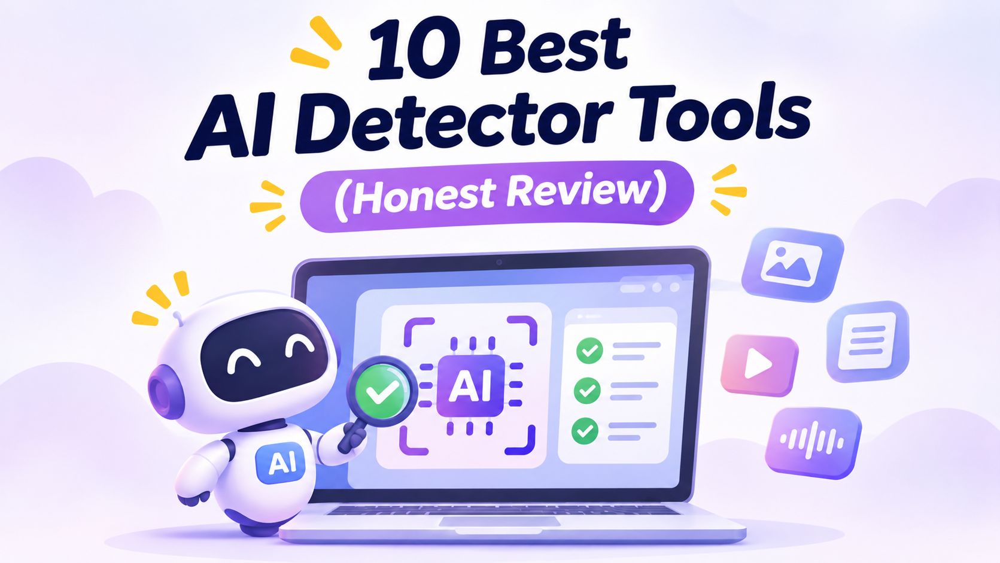

# 10 Best AI Detector Tools (Honest Review)

AI-generated content is becoming common across websites, blogs, schools, businesses, and social media platforms. Tools like ChatGPT can create articles, essays, emails, and other content within seconds. Because of this, it is becoming difficult to identify whether content was written by a human or generated using AI.

An [**AI Detector**](https://www.yttags.com/ai-detectors/) helps analyze text and estimate whether it may have been created by artificial intelligence. These tools are useful for students, teachers, bloggers, website owners, editors, and content agencies.

However, no AI detector can guarantee 100% accuracy. Sometimes, human-written content is marked as AI-generated, and AI-written content may pass detection. Therefore, detector results should be treated as helpful signals rather than final proof.

In this guide, we have listed 10 of the best AI detector tools in 2026. We will look at their key features, advantages, disadvantages, pricing, and overall performance to help you choose the right option.

### 🔍 [Try AI Detector →](https://www.yttags.com/ai-detectors/)

## Quick Comparison of the 10 Best AI Detector Tools

| AI Detector | Best For | Free Plan | Starting Paid Price |
|---|---|---|---|
| GPTZero | Students and teachers | Yes | $12.99/month annually |
| Originality.ai | Bloggers and publishers | Limited | $12.95/month annually |
| Copyleaks | AI and plagiarism detection | Limited access | $13.99/month annually |
| Winston AI | Educators and content teams | Limited trial | From $12/month annually |
| QuillBot AI Detector | Everyday writing checks | Yes | $8.33/month annually |
| Sapling AI Detector | Developers and short text checks | Yes | $12/month annually |
| ZeroGPT | Quick AI text checks | Yes | Check current paid pricing |
| Scribbr AI Detector | Students and academic writing | Yes | Free detector |
| Hive AI Detector | Multiple media types | Limited access | Usage-based |
| AI or Not | Text, images, audio, and video | Free credits | $5/month |

*Prices are in USD. Annual billing prices are shown as monthly equivalents where applicable. Prices and plan features may change.*

### 🖼️ [Try AI Image Detector →](https://www.yttags.com/ai-image-detector/)

## 1. GPTZero

**Best For:** Students, teachers, and educational institutions

GPTZero is one of the popular tools for checking whether written content may have been generated by AI. It is commonly used by students, teachers, and educational institutions to review essays, assignments, and reports. Users can paste text or upload supported documents for analysis. The platform provides detection results and highlights areas that may need additional review.

### Key Features

- AI-generated text detection.
- Sentence-level AI highlighting.
- Document upload and scanning.
- Writing analysis features.
- Support for educational workflows.
- Free plan for basic checks.

### Pros & Cons

| Pros | Cons |
|---|---|
| Easy-to-use interface | Free plan has monthly limits |
| Useful for students and teachers | Results are not always accurate |
| Highlights suspicious sentences | Advanced features require payment |
| Supports document analysis | Human writing can receive false AI scores |

### Pricing

GPTZero offers a free plan with up to 10,000 words per month. Its Premium plan is listed at approximately $12.99 per month with annual billing or $23.99 month-to-month. The Professional plan is approximately $24.99 per month with annual billing or $45.99 month-to-month.

### Review

GPTZero is a useful option for people who regularly review essays, articles, and other written documents. Its highlighting features make it easier to identify sections that deserve a closer look. It is especially suitable for education-related use. However, users should not make important decisions based only on its detection score.

### 🎙️ [Explore 7 Best AI Voice Detectors →](https://www.yttags.com/7-best-ai-voice-detectors/)

## 2. Originality.ai

**Best For:** Bloggers, publishers, SEO professionals, and content agencies

Originality.ai is designed for website owners and content teams that want to check the originality of their published material. It combines AI detection with plagiarism checking and other content review features. Users can scan articles, documents, and website pages. Its reporting and team features are helpful for editors who work with multiple writers.

### Key Features

- AI content detection.
- Plagiarism checking.
- Website and document scanning.
- Shareable reports.
- Team management features.
- API access on supported plans.

### Pros & Cons

| Pros | Cons |
|---|---|
| Combines AI detection and plagiarism checks | Regular use requires a paid plan |
| Useful for website publishers | Results can include false positives |
| Supports document and website scans | Credits are limited by plan |
| Helpful for editorial teams | May be expensive for occasional users |

### Pricing

Originality.ai offers a limited free option with three scans per day and a 2,000-word limit per scan. Its Pro plan costs $12.95 per month with annual billing or $14.95 month-to-month. The Enterprise plan is listed at $136.58 per month annually or $179 month-to-month.

### Review

Originality.ai is a good choice for bloggers, publishers, and agencies that regularly review content before publishing. Its combination of AI detection and plagiarism checking makes it more useful than a basic text checker. It is particularly helpful for editorial workflows, although its credit system should be considered before purchasing.

### 🎬 [Try AI Video Detector →](https://www.yttags.com/ai-video-detectors/)

## 3. Copyleaks

**Best For:** Schools, businesses, and plagiarism checking

Copyleaks provides AI content detection and plagiarism checking in one platform. It is designed for educational institutions, businesses, and professional content teams. Users can scan documents to identify possible AI-generated text and copied content. The platform also offers additional detection capabilities for certain types of digital media.

### Key Features

- AI-generated text detection.
- Plagiarism checking.
- Multiple-language support.
- Document scanning.
- AI image detection capabilities.
- Integrations and API options.

### Pros & Cons

| Pros | Cons |
|---|---|
| AI detection and plagiarism checking together | Paid plans may be costly |
| Supports multiple languages | Credit limits depend on the plan |
| Useful for educational institutions | Results still require human review |
| Offers additional detection features | Interface may feel complex to beginners |

### Pricing

Copyleaks offers different subscription options. Its Personal plan is listed at $13.99 per month with annual billing or $16.99 month-to-month. Its Pro plan costs $74.99 per month annually or $99.99 month-to-month.

### Review

Copyleaks is a practical choice for users who need AI detection and plagiarism checking in the same place. Its language support and additional features make it suitable for schools and businesses. Users who also need to review AI-created images can explore our guide to the [AI Image Detector](https://www.yttags.com/ai-image-detector/).

### 📈 [Explore Best Sites to Buy YouTube Views →](https://www.yttags.com/best-sites-to-buy-youtube-views/)

## 4. Winston AI

**Best For:** Teachers, writers, and professional content reviewers

Winston AI is a content detection platform that helps users check whether text may have been created using AI. It supports document scanning and provides reports that can help reviewers understand the results. The platform is designed for educators, publishers, and businesses that regularly review written content. It also offers OCR capabilities for supported document workflows.

### Key Features

- AI-generated text detection.
- Document scanning.
- OCR support for selected documents.
- Shareable reports.
- Team and workspace options.
- Additional content review features.

### Pros & Cons

| Pros | Cons |
|---|---|
| Easy-to-understand reports | Free access is limited |
| Useful for teachers and editors | Frequent use may require a subscription |
| Supports document workflows | Detection is not guaranteed |
| Offers team-oriented features | Some features depend on the plan |

### Pricing

Winston AI offers a limited free trial with credits. Its paid plans include Essential, Advanced, and Team options. Annual billing has been listed at approximately $12, $20, and $36 per month, respectively. Monthly billing may cost more.

### Review

Winston AI is worth considering if you regularly review essays, articles, or business documents. Its document scanning and reporting features make the checking process easier. It can help identify content that deserves additional attention, but the final review should always involve human judgment.

### 📄 [Try Fake PDF Detector →](https://www.yttags.com/fake-pdf-detector/)

## 5. QuillBot AI Detector

**Best For:** Students, bloggers, and everyday writers

QuillBot is widely known for its writing and paraphrasing tools, and it also provides an AI detector. Users can paste their content into the detector to receive an estimate of whether it may have been generated by AI. Its simple interface makes it convenient for beginners. It is especially useful for people who already use QuillBot for writing and editing tasks.

### Key Features

- AI-generated text checking.
- Simple text input.
- Easy-to-understand results.
- Grammar and paraphrasing tools.
- Free access with usage limits.
- Additional writing tools.

### Pros & Cons

| Pros | Cons |
|---|---|
| Beginner-friendly interface | Free checks have limits |
| Convenient for quick checks | Results are only estimates |
| Includes other writing tools | Advanced writing features require Premium |
| Useful for students and bloggers | Not a complete editorial review system |

### Pricing

QuillBot offers a free plan with limited AI detector access. Its Premium plan is listed at approximately $8.33 per month with annual billing or $19.95 month-to-month. Pricing may vary depending on the region and available offers.

### Review

QuillBot AI Detector is a convenient choice for people who want a quick content check. It is easy to use and works well alongside its other writing features. However, users who need advanced reporting, team management, or large-scale document analysis may prefer a dedicated AI detection platform.

### 🧾 [Explore 5 Best Fake Receipt Detectors →](https://www.yttags.com/5-best-fake-receipt-detectors/)

## 6. Sapling AI Detector

**Best For:** Developers, businesses, and short text checks

Sapling provides an AI detector as part of its writing assistance platform. It estimates whether a piece of text may have been generated by an AI model. The tool is useful for checking short passages and can also support developers through its API options. Its writing assistance features make it suitable for everyday business communication.

### Key Features

- AI text detection.
- Short text checking.
- Longer checks on paid plans.
- API access for developers.
- Writing suggestions.
- Browser and document integrations.

### Pros & Cons

| Pros | Cons |
|---|---|
| Free plan available | Free checks are limited to 2,000 characters |
| Offers API access | Advanced usage requires payment |
| Useful for developers | Interface is relatively simple |
| Includes writing assistance | Detection results are not guaranteed |

### Pricing

Sapling offers a free plan at $0 per month, with AI detector checks up to 2,000 characters per check. Its Pro plan costs $25 per month or an annual equivalent of $12 per month. API access uses metered pricing, while Enterprise plans are custom.

### Review

Sapling is a practical option for users who want basic AI detection with writing assistance. Its API is useful for developers who want to include detection in their own applications. The free plan works for short passages, while users checking longer documents may need the Pro plan.

### 🪪 [Try Fake ID Detector →](https://www.yttags.com/fake-id-detector/)

## 7. ZeroGPT

**Best For:** Quick AI text checks and casual users

ZeroGPT is an online AI detector that allows users to paste text and check whether it may have been generated by AI. Its simple interface makes it accessible to beginners who do not need a complicated content review platform. It is commonly used for quick checks of essays, articles, and online content. The results provide an initial indication rather than a guaranteed answer.

### Key Features

- AI-generated text detection.
- Quick text scanning.
- Free checking option.
- Easy-to-read results.
- Additional plans for higher usage.
- Support for different languages.

### Pros & Cons

| Pros | Cons |
|---|---|
| Simple and quick to use | Results may not always be reliable |
| Free option available | Free usage may have limits |
| No complicated setup | Fewer advanced team features |
| Suitable for basic checks | Can misidentify human-written content |

### Pricing

ZeroGPT offers a free plan for basic AI detection. Paid options are also available, but the exact cost and usage limits should be checked before subscribing because plan details can change.

### Review

ZeroGPT is suitable for people who want to run a quick AI content check without creating a complicated workflow. It is useful for casual users and basic writing reviews. For important academic or business decisions, compare its results with other evidence rather than relying on one score.

## 8. Scribbr AI Detector

**Best For:** Students and academic writing

Scribbr offers a free AI detector that helps students and writers review text for possible AI-generated content. Its simple design makes it easy to use when checking essays, reports, and academic documents. The tool is part of Scribbr's wider collection of academic writing resources. It can be useful as an initial check before submitting written work.

### Key Features

- Free AI text detection.
- Simple text-based checking.
- Useful for essays and academic writing.
- Easy-to-use interface.
- Part of a wider academic writing platform.

### Pros & Cons

| Pros | Cons |
|---|---|
| Free AI detector | Fewer advanced features |
| Beginner-friendly interface | Results can be incorrect |
| Useful for academic writing checks | Not a complete authorship investigation |
| No complex setup for basic checks | Usage limits may apply |

### Pricing

Scribbr's AI detector is available for free. Other services offered by Scribbr, such as proofreading and plagiarism-related services, may have separate charges.

### Review

Scribbr is a helpful option for students who want a free AI detection check. Its straightforward interface makes it easy to review text without needing a paid subscription. However, students should keep their drafts, notes, and source material because an AI detector score alone cannot prove who wrote an assignment.

## 9. Hive AI Detector

**Best For:** Businesses checking text, images, and videos

Hive offers AI detection tools that cover more than written content. Depending on the model and service, its detection tools can help identify AI-generated images, videos, and text. This makes it relevant to businesses, online platforms, and teams that review different types of digital media. Its API options can also support automated content review workflows.

### Key Features

- AI-generated content detection.
- Image detection options.
- Video detection options.
- Text detection capabilities.
- API-based integration.
- Usage-based services.

### Pros & Cons

| Pros | Cons |
|---|---|
| Supports multiple types of media | Pricing can be difficult to estimate |
| Useful for business workflows | Not as simple as a basic text checker |
| API options are available | Some services charge by usage |
| Supports automated content review | Results depend on the model and media type |

### Pricing

Hive uses usage-based pricing for many detection services instead of one standard monthly subscription. Costs depend on the model, content type, and number of requests. Businesses should estimate their expected usage before choosing a service.

### Review

Hive is better suited to businesses and developers than to someone who only wants to check a short paragraph. Its broader media detection options make it useful for platforms that handle images, videos, and other digital content. If you also need to review voice recordings, our guide to [7 Best AI Voice Detectors](https://www.yttags.com/7-best-ai-voice-detectors/) may help. You can also explore [AI Video Detectors](https://www.yttags.com/ai-video-detectors/) for video-related checks.

## 10. AI or Not

**Best For:** Checking AI-generated images, audio, video, and text

AI or Not is a detection platform designed to examine different types of digital content. Depending on the service, users can check whether media may have been generated or altered using AI. It can be useful for content teams, businesses, and people who need to review files from different sources. Its credit-based model allows users to pay according to the type and volume of checks.

### Key Features

- AI text detection.
- AI image detection.
- Audio and voice detection.
- Video detection.
- API and business options.
- Credit-based usage.

### Pros & Cons

| Pros | Cons |
|---|---|
| Supports multiple media types | Costs depend on usage |
| Useful for different content workflows | Not every feature suits casual users |
| Offers free starting credits | Results need human verification |
| API options for businesses | High-volume checks may become expensive |

### Pricing

AI or Not offers free starting credits. Its Pro plan is listed at $5 per month and includes monthly credits. Usage rates vary by content type, so the total cost depends on how much text, image, audio, or video content you check.

### Review

AI or Not is a useful option when you need to check more than written content. Its support for multiple media types makes it relevant to content verification and moderation workflows. Before using it regularly, review the credit system and estimate the cost of your expected usage.

## How to Choose the Best AI Detector

Choosing the right AI detector depends on what you want to check and how often you need to use it. A free tool may be enough for occasional text checks, while a publisher or business may need detailed reports and team features.

Here are some important points to consider:

- **Accuracy:** Look for tools that explain their results and limitations. Do not rely on a single percentage score.
- **Content Type:** Some detectors focus on text, while others also check images, audio, or video.
- **Pricing:** Compare free limits, monthly costs, credits, and annual billing.
- **Ease of Use:** Choose a tool that makes reports easy to understand.
- **Privacy:** Check how the platform stores uploaded text and files, especially when reviewing confidential documents.
- **Workflow:** If you work with a team, look for report sharing, API access, and account management.

## Other Useful Tools for Digital Content Creators

AI detection is only one part of creating and managing online content. YouTube creators may also need help with keyword research, hashtags, and channel growth. Our guides to [11 Best YouTube Keyword Generator Tools](https://www.yttags.com/11-best-youtube-keyword-generator-tools/) and [Top 9 YouTube Hashtags Generators](https://www.yttags.com/top-9-youtube-hashtags-generator/) can help with content planning.

Creators interested in channel promotion can also read about [Best Sites to Buy YouTube Views](https://www.yttags.com/best-sites-to-buy-youtube-views/). If you are exploring AI music creation rather than detection, see our guide to the [Best AI Song Generators](https://www.yttags.com/best-ai-song-generator/).

## Other Digital Verification Tools

AI-generated content is not the only digital material that may need verification. Businesses and individuals may also need to review documents, receipts, and identity-related files.

For document checks, you can explore our guide to [Fake PDF Detectors](https://www.yttags.com/fake-pdf-detector/). Businesses that review expense documents may find our list of [5 Best Fake Receipt Detectors](https://www.yttags.com/5-best-fake-receipt-detectors/) useful. For identity document verification, read our guide to [Fake ID Detectors](https://www.yttags.com/fake-id-detector/).

These tools serve different purposes, so choose one based on the type of file you need to review.

## Are AI Detectors 100% Accurate?

No. AI detectors are not 100% accurate. They look for patterns that may be common in AI-generated writing, but human writing can sometimes share those patterns. Similarly, AI-generated content can be edited enough to receive a different result.

A detector score should be treated as an estimate, not proof. For academic, professional, or legal decisions, review the original drafts, writing history, sources, and other available evidence.

## Frequently Asked Questions About AI Detectors

### 1. What is an AI Detector?

An AI detector is a tool that analyzes text or media and estimates whether it may have been generated by artificial intelligence. Some tools focus on writing, while others can check images, audio, or video.

### 2. Which is the best AI detector?

The best option depends on your needs. GPTZero is useful for education, Originality.ai suits publishers, Copyleaks combines AI and plagiarism checks, and Hive supports different media types.

### 3. Are free AI detectors reliable?

Free AI detectors can be useful for quick checks, but their results are not guaranteed. Different tools may give different scores for the same text, so it is better to use them as a guide.

### 4. Can AI detectors identify ChatGPT content?

Many AI detectors are designed to identify patterns associated with AI-generated writing, including text produced by ChatGPT. However, they cannot guarantee that a particular passage came from ChatGPT or another specific model.

### 5. Can human-written content be flagged as AI?

Yes. Human-written text can sometimes receive an AI-generated score. This is known as a false positive and is one reason detector results should not be treated as final proof.

### 6. Can AI detectors check images and videos?

Some platforms support image and video detection, but not every text detector offers these features. Copyleaks, Hive, and AI or Not provide options for checking media beyond text.

### 7. Should I use more than one AI detector?

For important content reviews, using more than one detector can provide additional context. However, even if multiple tools agree, their results should still be checked against other evidence.

## Final Thoughts

AI detectors can help students, teachers, bloggers, publishers, and businesses review digital content. Tools such as GPTZero, Originality.ai, Copyleaks, Winston AI, and QuillBot are useful for text checks, while Hive and AI or Not offer broader media detection options.

The right choice depends on your budget, content type, and required features. Start with a free plan if you only need occasional checks, and consider a paid subscription if you regularly review large documents or work with a team.

Most importantly, remember that an AI detector gives an estimate—not a final answer about who created the content. Use it alongside human judgment for a more balanced review.
